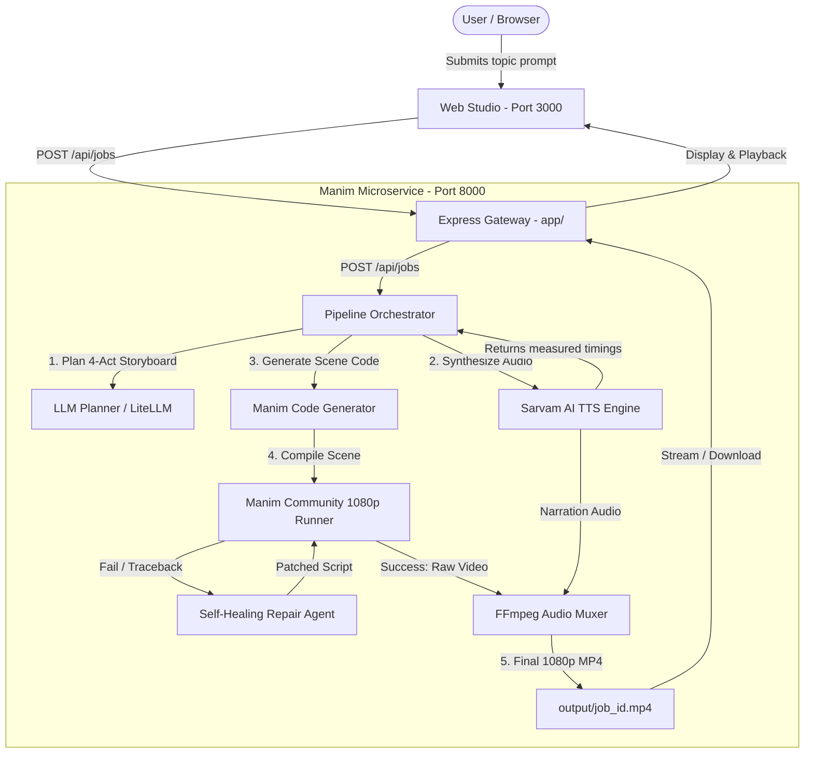

# Shawtty 🎬

> **Autonomous 9:16 Vertical Motion-Graphics Reel Generator**  
> Built with Python **Manim Community Edition**, LLM Planning, **Sarvam AI Voiceover**, and a Self-Healing Code Repair Loop.

Shawtty turns any text topic into a polished, high-definition 1080x1920 vertical video reel. Designed for technical educators, developers, and creators, it crafts 3Blue1Brown-style explanatory motion graphics with synchronized voiceover narration—completely hands-free.

---

## 🌟 Highlights

- **Pure Manim Community Engine**: Crisp vector typography, smooth geometric transformations, dynamic graphs, and technical architecture diagrams rendered at 1080x1920 (9:16).
- **Synchronized Voiceover**: Narration powered by **Sarvam AI** (`bulbul:v4-flash`), audio duration measurement down to the millisecond, and automatic scene timing alignment.
- **Self-Healing LLM Repair Agent**: If a generated Manim script triggers a runtime exception or syntax error, an intelligent repair agent analyzes the Python traceback and compiler stderr to patch and re-compile automatically (up to 3 retries).
- **Embedded SVG Icon Library**: Bundled vector icons for cloud infrastructure, databases, servers, security, and networking.
- **Dual-Interface Flexibility**:
  - **Main Web Studio** (`localhost:3000`): Full prompt suite, job tracking, and reel viewer.
  - **Manim Service UI** (`localhost:8000`): Dedicated Python microservice playground with live code inspector and raw code renderer.
- **Containerized Deployment**: One-command launch with `docker-compose`.

---

## 🏗️ Architecture



---

## 🚀 Quickstart

### Method 1: Docker Compose (Recommended)

The fastest and most reliable way to run Shawtty with all system dependencies (Python 3.11, Manim Community, FFmpeg, Cairo, Pango, and Node.js):

1. **Clone the repository:**
   ```bash
   git clone https://github.com/atharvdange618/Shawtty.git
   cd Shawtty
   ```

2. **Configure environment variables:**
   ```bash
   cp app/.env.example app/.env
   cp manim-service/.env.example manim-service/.env
   ```
   Add your API keys in `app/.env` and `manim-service/.env`:
   - `LLM_API_KEY`: LiteLLM / Anthropic / OpenAI key for script planning and code generation.
   - `SARVAM_API_KEY`: Sarvam AI subscription key for natural voiceover.

3. **Start the containers:**
   ```bash
   docker compose up --build
   ```

4. **Open your browser:**
   - **Main Studio**: [http://localhost:3000](http://localhost:3000)
   - **Manim Service Console**: [http://localhost:8000](http://localhost:8000)

---

### Method 2: Running Locally (Bare Metal)

#### Prerequisites
- **Node.js**: `v20.x` or `v22.x`
- **Python**: `3.10+` or `3.11+`
- **FFmpeg**: Installed and accessible on your system `PATH`
- **Manim Community System Libraries**:
  - **Windows**: Install [MiKTeX](https://miktex.org/) (optional for LaTeX) and ensure FFmpeg is in PATH.
  - **macOS**: `brew install cairo pango ffmpeg`
  - **Ubuntu/Debian**: `sudo apt install libcairo2-dev libpango1.0-dev ffmpeg`

#### 1. Setup & Run `manim-service` (Port 8000)

```bash
cd manim-service

# Create and activate Python virtual environment
python -m venv .venv
# On Windows:
.venv\Scripts\activate
# On Linux/macOS:
# source .venv/bin/activate

# Install Python dependencies
pip install -r requirements.txt

# Configure .env
cp .env.example .env
# Edit .env with your keys

# Start FastAPI server
uvicorn service.main:app --host 0.0.0.0 --port 8000 --reload
```

#### 2. Setup & Run Express Gateway (`app/` - Port 3000)

```bash
cd ../app

# Install Node dependencies
npm install

# Configure .env
cp .env.example .env

# Verify environment
npm run check

# Start Express server
npm run dev
```

Navigate to `http://localhost:3000` to start creating reels!

---

## ⚙️ Environment Configuration

### Gateway (`app/.env`)

| Variable | Default | Description |
|---|---|---|
| `PORT` | `3000` | Port for the Express gateway |
| `MANIM_SERVICE_URL` | `http://localhost:8000` | URL of the Manim microservice (use `http://manim-service:8000` in Docker) |
| `PROMPT_MAX_CHARS` | `20000` | Maximum prompt length |

### Manim Service (`manim-service/.env`)

| Variable | Default | Description |
|---|---|---|
| `LLM_API_KEY` | *(required)* | API key for LLM generation |
| `LLM_BASE_URL` | `https://litellm.vision.aivar.app/v1` | LiteLLM or OpenAI-compatible endpoint |
| `VIDEO_MODEL` | `claude-opus-4.6` | Model used for script planning and Manim code generation |
| `SARVAM_API_KEY` | *(recommended)* | Sarvam AI key for primary voiceover synthesis |
| `SARVAM_BASE_URL` | `https://api.sarvam.ai` | Sarvam AI API URL |
| `SARVAM_MODEL` | `bulbul:v4-flash` | TTS model |
| `SARVAM_SPEAKER` | `shubh_enhi_ads` | Voice profile (`shubh_enhi_ads`, `ritu`, `aditya`, etc.) |
| `PORT` | `8000` | Port for the FastAPI microservice |

---

## 📖 App Usage Guide

### 1. Generating a Reel via Web UI

1. Open `http://localhost:3000`.
2. Enter your topic prompt in the input box. For example:
   - *"How Redis pub/sub works vs message queues with worker pools"*
   - *"Understanding Raft Consensus Algorithm in distributed databases"*
   - *"OAuth 2.0 Authorization Code flow with PKCE"*
3. Click **Generate Reel**.
4. Track real-time pipeline status:
   - **Phase 1**: 4-act narrative storyboard planning.
   - **Phase 2**: Sarvam AI voiceover audio synthesis.
   - **Phase 3**: Time-synchronized Manim scene generation.
   - **Phase 4**: 1080p Manim rendering (with automatic self-healing repair if needed).
   - **Phase 5**: Final audio muxing & video delivery.
5. Watch the preview in the browser or download the completed `.mp4`.

### 2. Standalone Manim Service Console

Visit `http://localhost:8000` for the direct developer console:
- Test custom prompts directly against the Python microservice.
- Inspect the generated Manim code and retry records.
- View rendered raw outputs.

---

## 📡 API Reference

### Express Gateway (`http://localhost:3000`)

| Method | Endpoint | Description |
|---|---|---|
| `GET` | `/api/health` | Health status and gateway config |
| `GET` | `/api/jobs` | List recent video generation jobs |
| `POST` | `/api/jobs` | Submit a new generation job: `{"prompt": "string"}` |
| `GET` | `/api/jobs/:id` | Poll job progress, logs, and `videoUrl` |
| `GET` | `/reel/:id/reel.mp4` | Stream or download the completed 1080p video |

### Manim Microservice (`http://localhost:8000`)

| Method | Endpoint | Description |
|---|---|---|
| `GET` | `/api/health` | Service health, engine info, and output directory |
| `POST` | `/api/jobs` | Submit job: `{"prompt": "string", "quality": "h", "max_retries": 3}` |
| `GET` | `/api/jobs` | List active and historical jobs |
| `GET` | `/api/jobs/{job_id}` | Retrieve job state, generated code, and attempt logs |
| `GET` | `/output/{job_id}.mp4` | Stream rendered MP4 file |

---

## 📂 Project Structure

```text
Shawtty/
├── app/                              # Express Gateway & Frontend
│   ├── public/                       # Frontend Web UI (HTML, CSS, JS)
│   ├── server/                       # Express server & job proxy
│   │   ├── config.ts                 # Configuration loader
│   │   ├── index.ts                  # Server entrypoint & routing
│   │   └── jobs.ts                   # Orchestration proxy & video streamer
│   ├── scripts/                      # Utility scripts (check-env.ts)
│   ├── Dockerfile                    # Express Docker container
│   └── package.json                  # Node dependencies & scripts
│
├── manim-service/                    # Standalone Python Manim Engine
│   ├── service/                      # Core FastAPI Service
│   │   ├── assets/icons/             # Bundled SVG icons (cloud, server, db, etc.)
│   │   ├── config.py                 # Python configuration
│   │   ├── llm_client.py             # Resilient multi-endpoint LLM client
│   │   ├── main.py                   # FastAPI application & REST endpoints
│   │   ├── manim_generator.py        # 4-Act narrative planner & code generator
│   │   ├── manim_runner.py           # Sandboxed Manim CLI runner (1080p, 60fps)
│   │   ├── orchestrator.py           # Pipeline orchestrator & step manager
│   │   ├── repair_agent.py           # Self-healing traceback diagnosis & patcher
│   │   ├── static/                   # Standalone service developer UI
│   │   └── tts.py                    # Sarvam AI TTS client & audio muxing
│   ├── Dockerfile                    # Manim Community + FFmpeg container
│   ├── docker-compose.yml            # Standalone service compose file
│   └── requirements.txt              # Python dependencies (fastapi, manim, etc.)
│
├── docker-compose.yml                # Full-stack composition (app + manim-service)
├── docs/                             # Architecture specifications & design docs
└── README.md                         # Project documentation
```

---

## 🧪 Quality & Verification

Verify the Node.js TypeScript codebase:

```bash
cd app
npm run typecheck    # Strict TypeScript verification across server & scripts
npm run check        # Environment variables & Manim service connectivity check
```

---

## 📄 License

MIT
